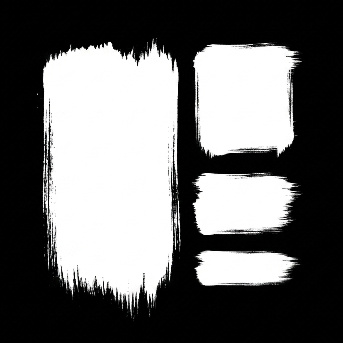

<p align="center">
  
</p>

<p align="center">
  
  
  
  
</p>

<p align="center">
  <strong>A fast terminal multiplexer for panes, tabs, and keyboard-first workflows.</strong>
</p>

# koshi

Koshi runs panes and tabs inside one terminal window. Each pane has its own
process, terminal screen, and scrollback.

## Requirements

- Linux, macOS, or Windows
- On Linux, glibc 2.34 or newer, such as Ubuntu 22.04 or Debian 12 and newer
- x86-64 or ARM64
- A terminal with true color and 256-color support
- Rust 1.96 to build from source

## Why Koshi?

Koshi keeps the core focused on terminal work. Panes, tabs, layouts,
keybindings, themes, and saved layouts are built in. App settings stay in
small KDL files, and shell commands can control a running session.

- **Your keybindings stay on your machine.** Your terminal reads your own
  `keybinding.kdl` and sends the session only the action: `<C-p> l` sends
  `core:new-pane-right`. Your shortcuts work the same on a session on another
  machine.
- **Each attached terminal keeps its own view.** Focus, active tab, zoom,
  scroll position, selection and lock mode belong to the terminal. Two people
  on one session never move each other's screen.
- **A session outlives its terminals.** Close the terminal, and the panes keep
  running. Reattach from this machine or another one.

> [!IMPORTANT]
> `auto-close-session #true` in `koshi.kdl` ends the session when its last
> terminal leaves. The default `#false` keeps it running. See
> [config-docs/koshi.md](config-docs/koshi.md#auto-close-session).

## Features

- 🪟 **Split panes** — open panes left, right, up, or down; layouts fill the tab.
- 🗂️ **Stacked panes** — place several panes in one slot and switch the expanded pane.
- 🔍 **Fullscreen pane** — fill the tab with one pane and restore the prior layout.
- 📐 **Resize** — move borders by keyboard or drag them with the mouse.
- ↔️ **Pane placement** — move tiled and stacked panes with keyboard or mouse, preview affected panes, and swap or insert panes within or across tabs.
- 🎈 **Floating panes** — float a pane above its tab, move and pin it by keyboard, resize it with the mouse, minimize and restore it, and dock it back into a tab; the floating pane tray lists every floating pane.
- ↔️ **Pane gaps** — `pane { gap N }` leaves blank cells between split panes; every attached terminal sees the same gaps.
- 📑 **Tabs** — create, close, move, and switch tabs.
- ⌨️ **Multi-key shortcuts** — use key sequences, a configurable leader, hints, and conflict checks.
- 🎹 **Complete keyboard events** — preserve key presses, repeats, releases, text, and modifiers from the outer terminal to pane programs through the kitty keyboard protocol.
- ▶️ **Actions from the shell** — `koshi actions run <ACTION>` runs any action a key can be bound to.
- 🔒 **Lock mode** — send keys directly to the active program.
- 🖱️ **Mouse support** — focus panes, resize borders, scroll, and select text; `Shift`+drag selects even while a program owns the mouse.
- 📋 **Clipboard copy** — copy mouse selections through OSC 52, including remote sessions. With `pane-clipboard-writes` on, a copy that a program in a pane makes, through OSC 52 or `pbcopy`, `xclip`, `xsel` or `wl-copy`, reaches your clipboard too.
- 🎯 **Mouse selection mode** — select text while a program owns mouse input.
- 👥 **Multi-client sessions** — attach several terminals to one session; each keeps its own focus, active tab, and zoom.
- 📜 **Per-pane history** — keep separate scrollback and scroll positions.
- 🧾 **Terminal support** — true color, text styles, alternate screens, CJK, emoji, and box drawing.
- 🖼️ **Terminal images** — programs draw Sixel, Kitty, and iTerm2 images; each image stays at its cells through scrolling, resizing, and reattaching, and paints in every terminal that can show it.
- 🔔 **Notification center** — a toast and a bell button show session notifications; `Alt+n` opens the notification center.
- 🐚 **Shell integration** — a shell that prints OSC 133 prompt markers gives each command a start and end event; koshi never records the command line or its output.
- 🔎 **Event log** — `koshi debug events` prints the last 1000 events a session published, filtered by age or name, with ids only and never typed text.
- 🎨 **Themes** — use the built-in colors or copy one of 25 included themes.
- ⚙️ **Config files** — keep app settings, themes, keybindings, and layouts separate.
- 💾 **Saved layouts** — start tabs, panes, commands, directories, environment values, and locked input from a profile.
- 🪵 **Logging** — write optional per-session and router text or JSON logs without terminal content, each file capped in size, with the logs of old sessions deleted.
- 🌐 **Remote sessions** — attach to a session on another machine over TLS 1.3 with hybrid post-quantum key exchange, a certificate fingerprint check, and an access token.
- 🔑 **Access tokens** — grant, revoke, and list the tokens that reach your sessions; each grant covers one session or every session.
- 🔁 **Reconnect** — a dropped remote link dials again for two minutes and puts your tabs, focus, and scroll position back.
- 👤 **Same-machine sharing** — let the other users of this machine list, attach to, and kill your sessions (macOS and Linux).
- ♻️ **Update in place** — `koshi update` restarts each running session into the new build, keeping its panes, their programs, and their scrollback.
- 🩺 **Installation check** — `koshi doctor` rates config, shell, terminal, directories, router, and remote access.
- 🌍 **Cross-platform** — run on Linux, macOS, or Windows; CI tests all three.

## Installation

Every way below downloads Koshi from the GitHub account `gohyuhan`, and is as
safe as that account. [config-docs/cli.md](config-docs/cli.md) states what
`koshi update` checks.

### Linux

```bash
curl --proto "=https" --tlsv1.2 -sSfL \
  https://github.com/gohyuhan/koshi/releases/latest/download/install.sh | bash
```

### macOS

Install with Homebrew:

```bash
brew install gohyuhan/koshi/koshi
```

`install.sh` does not install on macOS; it prints the Homebrew command. An
older script install keeps updating with `koshi update`. To move it to
Homebrew, run `sudo rm -f /usr/local/bin/koshi` first.

Homebrew adds the Koshi tap during installation. Upgrade Koshi with the other
outdated packages:

```bash
brew update
brew upgrade
```

Or upgrade only Koshi:

```bash
brew upgrade koshi
```

`koshi update` also upgrades a Homebrew install and restarts the running
sessions into it. See [config-docs/cli.md](config-docs/cli.md).

### Windows

Install with PowerShell:

```powershell
powershell -c "irm https://github.com/gohyuhan/koshi/releases/latest/download/install.ps1 | iex"
```

Run the same command to upgrade, also while Koshi runs. The script checks the
new `koshi.exe` before it replaces the installed one, and keeps the old one as
`koshi.old`. See [config-docs/cli.md](config-docs/cli.md).

Or install with Scoop:

```powershell
scoop bucket add koshi https://github.com/gohyuhan/scoop-koshi
scoop install koshi/koshi
```

Upgrade Koshi after refreshing Scoop:

```powershell
scoop update
scoop update koshi
```

`scoop update koshi` skips Koshi while it runs. Then run `koshi update`,
which replaces Koshi in place.

### Build from source

```bash
git clone https://github.com/gohyuhan/koshi.git
cd koshi
cargo build --release
./target/release/koshi
```

## Uninstall and clean removal

Exit every Koshi session before removing files.

### Linux

Remove a script-installed binary:

```bash
sudo rm -f /usr/local/bin/koshi
```

Remove all Koshi config, logs, update state, cache, runtime files, and the
remote data — the saved servers with their secrets and certificate
fingerprints, this machine's certificate, and the access tokens this machine
granted:

```bash
rm -rf "${XDG_CONFIG_HOME:-$HOME/.config}/koshi"
rm -rf "${XDG_DATA_HOME:-$HOME/.local/share}/koshi"
rm -rf "${XDG_STATE_HOME:-$HOME/.local/state}/koshi"
rm -rf "${XDG_CACHE_HOME:-$HOME/.cache}/koshi"
rm -rf "/tmp/koshi-$(id -u)"
```

### macOS

For a script install:

```bash
sudo rm -f /usr/local/bin/koshi
```

For a Homebrew install:

```bash
brew uninstall --force koshi
brew untap gohyuhan/koshi
```

Remove all Koshi config, logs, update state, cache, runtime files, and the
remote data — the saved servers with their secrets and certificate
fingerprints, this machine's certificate, and the access tokens this machine
granted:

```bash
rm -rf "$HOME/Library/Application Support/koshi"
rm -rf "$HOME/Library/Caches/koshi"
rm -rf "/tmp/koshi-$(id -u)"
```

### Windows

For a Scoop install:

```powershell
scoop uninstall koshi
scoop bucket rm koshi
scoop cache rm "koshi*"
```

For a PowerShell-script install, remove the PATH entry and install directory:

```powershell
$InstallDir = Join-Path $env:LOCALAPPDATA "koshi"
$UserPath = [Environment]::GetEnvironmentVariable(
    "Path",
    [EnvironmentVariableTarget]::User
)
$CleanPath = (($UserPath -split ";") | Where-Object {
    $_ -and $_ -ne $InstallDir
}) -join ";"
[Environment]::SetEnvironmentVariable(
    "Path",
    $CleanPath,
    [EnvironmentVariableTarget]::User
)
Remove-Item $InstallDir -Recurse -Force -ErrorAction SilentlyContinue
```

Remove all remaining Koshi config, logs, update state, cache, runtime files,
and the remote data — the saved servers with their secrets and certificate
fingerprints, this machine's certificate, and the access tokens this machine
granted:

```powershell
Remove-Item (Join-Path $env:APPDATA "koshi") `
  -Recurse -Force -ErrorAction SilentlyContinue
Remove-Item (Join-Path $env:LOCALAPPDATA "koshi") `
  -Recurse -Force -ErrorAction SilentlyContinue
```

## Quick start

Open one tab with one shell pane:

```bash
koshi
```

Open a saved layout:

```bash
koshi --profile dev
```

### Default keybindings

The default leader is Ctrl.

| Keys | Action |
|---|---|
| `<C-p> n` | Open pane using configured direction |
| `<C-p> h` / `j` / `k` / `l` | Open pane left / down / up / right |
| `<C-p> s` | Open pane in the focused pane's stack |
| `<C-p> f` | Open a floating pane above the tiled panes |
| `<C-p> m` | Enter pane placement mode: pick a pane and a destination, then Enter |
| `<C-p> u` | Float the focused pane, or dock the focused pane of a floating pane beside the tiled pane under its center |
| `<C-p> x` | Close pane and its process tree |
| `<C-p> ←` / `↓` / `↑` / `→` | Focus nearby pane |
| `<C-p> Tab` / `Shift+Tab` | Show and focus the next / previous floating pane |
| `<C-p> w` | Open or close the floating pane tray |
| `<C-p> i` | Pin or unpin the focused floating pane on your screen |
| `<C-s> ←` / `↓` / `↑` / `→` | Move pane border one cell |
| `<C-t> n` | Open tab |
| `<C-t> x` | Close tab |
| `Tab` / `Shift+Tab` | Next / previous tab |
| `Alt+f` | Toggle pane fullscreen |
| `Alt+n` | Open or close the notification center |
| `<C-g>` | Toggle mouse selection |
| `<C-l>` | Lock or unlock input |
| `<C-q>` | Quit |

The arrows under `<C-p>` and `<C-s>`, and `Tab` / `Shift+Tab` under `<C-p>`,
repeat: `<C-p> ← ← ↓` focuses left, left again, then down. `Esc` closes the
prefix. See [repeating keys](config-docs/keybinding.md#repeating-keys).

In locked mode, `<C-l>`, `<C-g>`, and `<C-q>` keep their actions, and every
other key goes to the program in the focused pane.

Drag a pane's grab handle `⠿⠿⠿`, shown when the pointer is over its top
border, onto another pane to swap the two. In pane placement mode (`<C-p> m`),
hold Shift when the drag starts to insert the pane instead. See
[pane placement mode](config-docs/keybinding.md#pane-placement-mode).

`koshi keys list` prints the active keymap. `koshi actions list` prints actions
that can be bound. `koshi actions run <ACTION>` runs one from a shell.

## Configuration

Koshi uses four optional KDL files. Each file declares `version 2`. A
`version 1` file migrates to version 2 when koshi reads it.

| File | Contents |
|---|---|
| `koshi.kdl` | Theme, image, reduced-motion, pane placement, pane, scrollback, layout, mouse, copy, notification toast, pane clipboard write, terminal, logging, update, beta-feature, session-closing, other-user access, and remote access settings |
| `themes/<name>.kdl` | Koshi interface colors |
| `keybinding.kdl` | Keybindings and input modes |
| `profile/<name>.kdl` | Tabs, pane layouts, commands, directories, environment values, and the starting input mode |

Config directories:

| Platform | Path |
|---|---|
| Linux | `~/.config/koshi` |
| macOS | `~/Library/Application Support/koshi` |
| Windows | `%APPDATA%\koshi\config` |

Available config commands:

| Command | Result |
|---|---|
| `koshi config path` | Print config directory |
| `koshi config explain <KEY>` | Print one setting's file, default, and meaning |
| `koshi config check` | Validate every known config file |
| `koshi config migrate` | Validate files and apply registered schema updates |

`koshi config check` reports every unknown key and bad value.

Full config reference: [config-docs/](config-docs/README.md). Ready-made themes:
[themes-example/](themes-example/).

## CLI reference

### Launching

| Command | Result |
|---|---|
| `koshi` | Start one session with one tab and shell pane |
| `koshi --profile <NAME>` | Start with `profile/<NAME>.kdl` |
| `koshi --headless` | Start a session with nothing attached, print its id, and return to the shell |
| `koshi --headless --allow-other-users` | The same, and let this machine's other users reach the session (macOS and Linux) |

### Sessions and discovery

List and inspect commands accept `--format table` or `--format json`.
`NAME_OR_ID` takes a generated name or a printed id.

| Command | Result |
|---|---|
| `koshi list-sessions` | List running sessions, here and on every saved server that answers |
| `koshi attach [NAME_OR_ID]` | Attach this terminal to that session, or choose from the running ones, saved servers included |
| `koshi detach [CLIENT_OR_SESSION] [--all]` | Detach one terminal, or with `--all` every terminal of a session |
| `koshi kill-session [NAME_OR_ID]` | End that session, or the only running session |
| `koshi list-tabs [--session <NAME_OR_ID>]` | List tabs |
| `koshi list-panes [--session <NAME_OR_ID>]` | List panes |
| `koshi list-clients [--session <NAME_OR_ID>]` | List attached clients |
| `koshi inspect session <NAME_OR_ID>` | Show one session |
| `koshi inspect tab <NAME_OR_ID>` | Show one tab |
| `koshi inspect pane <PANE_ID>` | Show one pane |
| `koshi inspect client <CLIENT_ID>` | Show one client, with the pane area it reports |

### Panes

Inside Koshi, omitted targets use the current session, tab, pane, or client.
Outside Koshi, give a target unless exactly one running session can be chosen.

| Command | Result |
|---|---|
| `koshi new-pane [--direction right\|down\|left\|up \| --stacked] [--pane <PANE_ID>] [--tab <NAME_OR_ID>] [--session <NAME_OR_ID>] [--client <CLIENT_ID>]` | Open a shell pane |
| `koshi run [new-pane options] -- <COMMAND>...` | Open a pane running one command |
| `koshi close-pane [--pane <PANE_ID>] [--force] [--all]` | Close a pane, or with `--all` every pane of its floating pane |
| `koshi resize-pane --direction <DIRECTION> [--size <SIZE>] [--pane <PANE_ID>] [--client <CLIENT_ID>]` | Move one pane border |
| `koshi move-pane --direction <DIRECTION> [--pane <PANE_ID>]` | Swap a pane with its visible neighbor |
| `koshi place-pane --pane <PANE_ID> --tab <NAME_OR_ID> --direction <DIRECTION> [--client <CLIENT_ID>]` | Insert a pane into another tab |
| `koshi scroll-pane --lines <LINES> [--pane <PANE_ID>] [--client <CLIENT_ID>]` | Scroll one client's view of a pane |
| `koshi focus-pane --pane <PANE_ID> [--client <CLIENT_ID>]` | Focus a pane |
| `koshi toggle-pane-fullscreen [--client <CLIENT_ID>]` | Toggle the focused pane's fullscreen view |
| `koshi input [--pane <PANE_ID>] [--no-enter] "<TEXT>"` | Send text to a pane |

### Tabs

| Command | Result |
|---|---|
| `koshi new-tab [--session <NAME_OR_ID>] [--client <CLIENT_ID>]` | Open a tab with one shell pane |
| `koshi close-tab [--tab <NAME_OR_ID>] [--session <NAME_OR_ID>] [--force]` | Close a tab |
| `koshi next-tab [--client <CLIENT_ID>]` | Focus the next tab |
| `koshi previous-tab [--client <CLIENT_ID>]` | Focus the previous tab |
| `koshi focus-tab (--index <INDEX>\|--tab <NAME_OR_ID>) [--client <CLIENT_ID>]` | Focus one tab |
| `koshi move-tab --index <INDEX> [--tab <NAME_OR_ID>]` | Move one tab |

Create commands print created ids. `new-pane` and `run` print one pane id.
`new-tab` prints its tab id and root pane id. `koshi --headless` prints its
session id.

### Input lock

| Command | Result |
|---|---|
| `koshi lock [--client <CLIENT_ID>]` | Send keys directly to the pane |
| `koshi unlock [--client <CLIENT_ID>]` | Restore Koshi shortcuts |
| `koshi toggle-lock [--client <CLIENT_ID>]` | Toggle locked input |

### Actions and shortcuts

| Command | Result |
|---|---|
| `koshi actions list [--format table\|json]` | List supported bindable actions |
| `koshi actions explain <ACTION> [--format table\|json]` | Explain one action and its targets |
| `koshi actions run <ACTION> [--client <CLIENT_ID>]` | Run one action as a key bound to it runs it |
| `koshi keys list [--mode <MODE>] [--scope default\|user]` | List active shortcuts |
| `koshi keys describe "<KEY_SEQUENCE>"` | Explain one shortcut and its source, or each shortcut it starts |
| `koshi keys conflicts` | Report clashes, unreachable shortcuts, and warnings |
| `koshi keys validate <PATH>` | Check a keybinding file without applying it |

### Checking the installation

| Command | Result |
|---|---|
| `koshi doctor [--format table\|json]` | Check this machine's koshi installation |

One row per check, each with a verdict of `ok`, `warn`, or `fail`, the fact
behind it, and what to do about it. The whole answer prints either way: a run
holding a `fail` row exits 1, and a run of only `ok` and `warn` rows exits 0.

### Sharing and remote access

The global `--remote <SERVER>` flag runs one command against another machine.
It works with `attach`, `list-sessions`, and the pane, tab and input commands.
A server this machine has not saved also needs `--certificate-fingerprint`,
which `koshi share grant` prints on that machine.

| Command | Result |
|---|---|
| `koshi share grant <IDENTITY> [--session <SESSION>] [--expires <DURATION>]` | Grant an identity a remote access token |
| `koshi share open` | Open the port remote clients connect to, and print the commands that connect |
| `koshi share revoke <IDENTITY> [--session <SESSION>]` | Revoke the tokens an identity holds |
| `koshi share list [--session <SESSION>] [--format table\|json]` | List the tokens granted on this machine |
| `koshi attach --remote <SERVER> [--certificate-fingerprint <FINGERPRINT>] [--save-as <NAME>] [SESSION]` | Attach to a session on the machine `SERVER` names |
| `koshi list-sessions --remote <SERVER> [--certificate-fingerprint <FINGERPRINT>]` | List the sessions on the machine `SERVER` names |
| `koshi remote new` | Save a server, asking for its name, address, certificate fingerprint and secret |
| `koshi remote edit <SERVER>` | Change one saved server's name, address, certificate fingerprint or secret |
| `koshi remote list [--format table\|json]` | List the servers this machine has saved |
| `koshi remote forget <SERVER>` | Drop one saved server |
| `koshi remote set-secret <SERVER>` | Replace the secret of one saved server |

The `share` commands run on the machine holding the sessions; the rest run on
the machine connecting to it.

An update keeps saved servers, certificates and grants; no re-enrollment is
needed.

### Debugging

| Command | Result |
|---|---|
| `koshi debug dump-state [--format table\|json]` | Print every running session's sessions, tabs, panes, and clients |
| `koshi debug dump-layout [--tab <NAME_OR_ID>] [--format table\|json]` | Print each tab's split tree, solved rectangles, each floating pane with what each client draws for it, and per-client focus |
| `koshi debug events [--since <LENGTH>] [--filter <NAME>] [--format table\|json]` | Print the events each running session published most recently, oldest first |

### Versions and updating

| Command | Result |
|---|---|
| `koshi version [--format table\|json]` | Print the build of the koshi program you just ran |
| `koshi server-version [--session <NAME_OR_ID>] [--format table\|json]` | Print the build each running koshi server runs |
| `koshi update` | Install a newer release the way koshi was installed, then restart the running servers |
| `koshi restart-servers` | Restart every running session, then the router, into the koshi program on disk |

`koshi update` installs the new release the way koshi was installed, then
restarts each running session and the router into it. Each session keeps its
panes, their programs and their scrollback. `koshi restart-servers` does the
same restart and installs nothing, for example after a package manager
upgrade. `koshi server-version` shows any session still on the old build.

A client attached during the update reattaches by itself. An older client, or
a client of another machine, prints the `koshi attach` command to run.
Sessions from koshi 0.3.0 and newer move in place, and saved state converts by
itself, also when an update skips a release.

If a session cannot read its restart record, it opens one new shell, and every
client that attaches gets an error notification.

Full flags and output rules: [config-docs/cli.md](config-docs/cli.md).

## Changelog

See [CHANGELOG.md](CHANGELOG.md) for release history.

## Contributing

Thank you for your interest in koshi. Koshi is not open to contributions at
the moment, because the maintainer cannot give pull requests the review time
they deserve. Bug reports are always welcome through the
[bug report template](.github/ISSUE_TEMPLATE/bug-report.md). You are also free
to fork koshi and build on top of it under the terms of the [license](LICENSE).

## License

MIT License. See [LICENSE](LICENSE).
